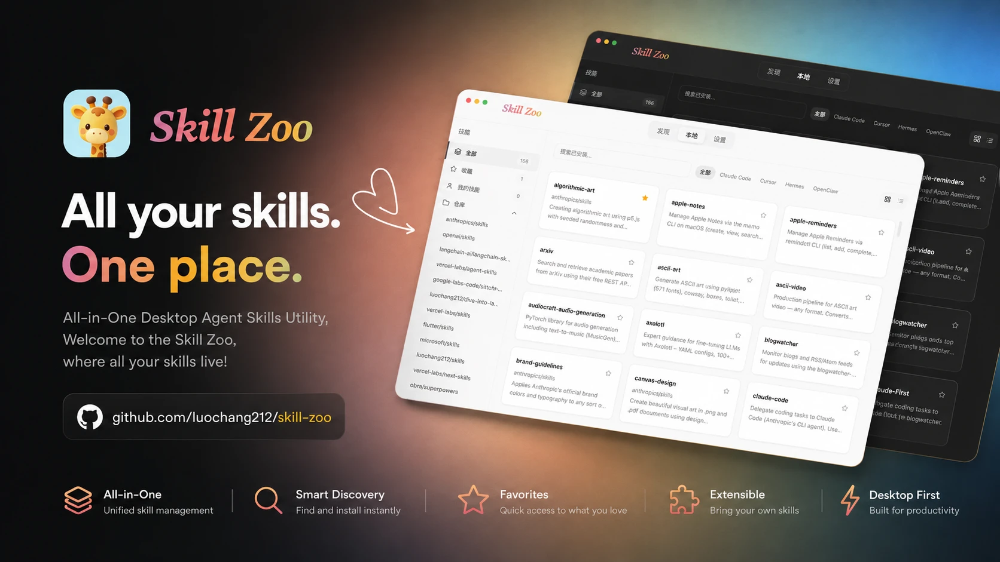

<div align="right">
  <a title="English" href="README.md"></a>
  <a title="简体中文" href="README_zh-CN.md"></a>
  <a title="Türkçe" href="README_tr.md"></a>
</div>

# Skill Zoo

[](https://github.com/luochang212/skill-zoo/releases)
[](https://github.com/luochang212/skill-zoo/releases)
[]()
[](LICENSE)
[![zread](https://img.shields.io/badge/%E2%80%8B-zread-0e7490?style=flat-square&logo=data%3Aimage%2Fsvg%2Bxml%3Bbase64%2CPHN2ZyB3aWR0aD0iMTYiIGhlaWdodD0iMTYiIHZpZXdCb3g9IjAgMCAxNiAxNiIgZmlsbD0ibm9uZSIgeG1sbnM9Imh0dHA6Ly93d3cudzMub3JnLzIwMDAvc3ZnIj4KPHBhdGggZD0iTTQuOTYxNTYgMS42MDAxSDIuMjQxNTZDMS44ODgxIDEuNjAwMSAxLjYwMTU2IDEuODg2NjQgMS42MDE1NiAyLjI0MDFWNC45NjAxQzEuNjAxNTYgNS4zMTM1NiAxLjg4ODEgNS42MDAxIDIuMjQxNTYgNS42MDAxSDQuOTYxNTZDNS4zMTUwMiA1LjYwMDEgNS42MDE1NiA1LjMxMzU2IDUuNjAxNTYgNC45NjAxVjIuMjQwMUM1LjYwMTU2IDEuODg2NjQgNS4zMTUwMiAxLjYwMDEgNC45NjE1NiAxLjYwMDFaIiBmaWxsPSIjZmZmIi8%2BCjxwYXRoIGQ9Ik00Ljk2MTU2IDEwLjM5OTlIMi4yNDE1NkMxLjg4ODEgMTAuMzk5OSAxLjYwMTU2IDEwLjY4NjQgMS42MDE1NiAxMS4wMzk5VjEzLjc1OTlDMS42MDE1NiAxNC4xMTM0IDEuODg4MSAxNC4zOTk5IDIuMjQxNTYgMTQuMzk5OUg0Ljk2MTU2QzUuMzE1MDIgMTQuMzk5OSA1LjYwMTU2IDE0LjExMzQgNS42MDE1NiAxMy43NTk5VjExLjAzOTlDNS42MDE1NiAxMC42ODY0IDUuMzE1MDIgMTAuMzk5OSA0Ljk2MTU2IDEwLjM5OTlaIiBmaWxsPSIjZmZmIi8%2BCjxwYXRoIGQ9Ik0xMy43NTg0IDEuNjAwMUgxMS4wMzg0QzEwLjY4NSAxLjYwMDEgMTAuMzk4NCAxLjg4NjY0IDEwLjM5ODQgMi4yNDAxVjQuOTYwMUMxMC4zOTg0IDUuMzEzNTYgMTAuNjg1IDUuNjAwMSAxMS4wMzg0IDUuNjAwMUgxMy43NTg0QzE0LjExMTkgNS42MDAxIDE0LjM5ODQgNS4zMTM1NiAxNC4zOTg0IDQuOTYwMVYyLjI0MDFDMTQuMzk4NCAxLjg4NjY0IDE0LjExMTkgMS42MDAxIDEzLjc1ODQgMS42MDAxWiIgZmlsbD0iI2ZmZiIvPgo8cGF0aCBkPSJNNCAxMkwxMiA0TDQgMTJaIiBmaWxsPSIjZmZmIi8%2BCjxwYXRoIGQ9Ik00IDEyTDEyIDQiIHN0cm9rZT0iI2ZmZiIgc3Ryb2tlLXdpZHRoPSIxLjUiIHN0cm9rZS1saW5lY2FwPSJyb3VuZCIvPgo8L3N2Zz4K&logoColor=ffffff)](https://zread.ai/luochang212/skill-zoo)
[](https://github.com/luochang212/skill-zoo/actions)




Yerel Agent Skills Yöneticisi: Claude Code, Codex, Cursor, Hermes, OpenClaw, Pi ve daha fazlası dahil olmak üzere yapay zeka kodlama araçları için becerileri (skills) keşfedin, yükleyin ve yönetin.

## ✨ Teknoloji Yığını

| Katman | Teknoloji |
|-------|-----------|
| Arayüz (Frontend) | React 19 + TypeScript 7 + Vite 8 |
| Arka Uç (Backend) | Rust (Tauri v2) |
| Stil | Tailwind CSS 4 + shadcn/ui |
| Durum Yönetimi | TanStack React Query |
| Animasyon | Framer Motion |
| Çoklu Dil (i18n) | i18next |
| Lint | oxlint + clippy |
| Biçimlendirme | oxfmt + cargo fmt |
| Test | Vitest + Rust testleri |
| Paket Yöneticisi | Bun |

## 🚀 Özellikler

- **Keşfet ve Yükle**: GitHub depolarından becerileri arayın ve indirin
- **Becerileri Güncelle**: Yüklü becerileri GitHub'daki en son sürüme güncelleyin
- **Beceri Oluşturma**: Her zaman, her yerde beceri oluşturmak için yerleşik Markdown düzenleyici
- **Toplu İşlemler**: Yinelenen becerileri toplu olarak yükleyin, silin veya birleştirin
- **Güvenlik Denetimi**: skills.sh üzerinden topluluk denetim puanlarını görüntüleyin
- **Tutarlılık Kontrolü**: Üç tür tutarsızlığı proaktif olarak tespit edin ve düzeltme önerileri alın
- **Beceri Arşivi**: Bağlam yükünü azaltmak için becerileri geçici depolama olarak arşive taşıyın
- **CLI + WUI**: Kodlama ajanları ve insanlar için Skill Zoo kontrol arayüzleri sağlar

## 🙌 CLI

Skill Zoo'yu bir kodlama ajanından, terminalden veya otomasyondan yönetmek istediğinizde npm CLI'yi yükleyin:

```bash
npm i -g skill-zoo
skill-zoo --help

skill-zoo list           # Yüklü becerileri listele
skill-zoo doctor fix     # Yaygın sorunları teşhis et ve düzelt
skill-zoo wui            # Yerel Web Arayüzünü başlat
```

Bakınız: [Skill Zoo CLI](https://www.npmjs.com/package/skill-zoo)

## 📦 Kurulum

En son sürümü [Releases](https://github.com/luochang212/skill-zoo/releases) sayfasından indirin.

### macOS

1. `.dmg` dosyasını indirin.
2. Açın ve `skill-zoo.app` dosyasını `Applications` klasörüne sürükleyin.

### Windows

1. `.exe` yükleyicisini indirin.
2. Çalıştırın. Yükleyici kısayollar oluşturur ve otomatik güncellemeleri destekler.

**Not:** SmartScreen bir uyarı gösterirse **"Ek bilgi"** ve ardından **"Yine de çalıştır"** seçeneğine tıklayın.

### Linux

İşlemci mimarinize uygun AppImage dosyasını indirin, ardından çalıştırın:

```bash
chmod +x Skill-Zoo-*-Linux-*.AppImage
./Skill-Zoo-*-Linux-*.AppImage
```

## 😇 Güven ve Güvenlik

- **Denetlenebilir Kod**: %100 açık kaynaklıdır. Her derleme herkesin inceleyebilmesi için GitHub Actions üzerinde çalışır.
- **İsteğe Bağlı Bağlantı**: Arka planda yoklama yapmaz. Ağ yalnızca göz atma veya yükleme sırasında, ayrıca uygulama güncellemeleri için ara sıra yapılan otomatik kontrollerde kullanılır (açılışta önbelleğe alınmış bir güncelleme varsa ve Ayarlar'da günde en fazla bir kez).
- **Kontrol Sizde**: Gerçek dosyalara dokunan her işlem (silme, taşıma, üzerine yazma) önce onay ister.

## 💡 Katkıda Bulunma

Geliştirme için [docs/development.md](docs/development.md) dosyasına bakın.

Bir hata mı buldunuz veya bir fikriniz mi var? Bir [issue](https://github.com/luochang212/skill-zoo/issues) açın veya PR gönderin. Her türlü katkı memnuniyetle karşılanır!

## 📜 Lisans

[MIT](LICENSE)
