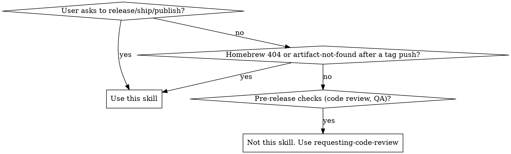

# Release

## Overview

Release is done by pushing a `v*` tag. CI validates the release metadata, builds all platforms, creates a GitHub Release, and then updates the website version and Homebrew cask. Manual steps: update the changelog and version files, commit them together, then tag and push. The workflow is asynchronous: after a successful tag push, report that the release was triggered; do not wait for CI unless the user explicitly asks.

**Announce at start:** "I'm using the release skill to ship a new version."

## When to Use



**Use when:**
- User says "release", "ship", "publish", "new version", "bump version"
- Homebrew cask update failed (404 on DMG URLs)
- CI `create-release` job failed to find artifacts

**Don't use for:**
- Code review before releasing
- Deciding WHAT version number (ask the user)
- Feature work or bug fixes

## Quick Reference

| Step | Command |
|------|---------|
| Check existing tags | `git tag --sort=-v:refname \| head -5` |
| Prerequisites (in order) | fmt → lint:rs → test → typecheck → lint → format:check → status |
| Check Rust formatting | `cargo fmt --check --manifest-path src-tauri/Cargo.toml` |
| Check Rust lint | `bun run lint:rs` |
| Check TypeScript types | `bun run typecheck` |
| Check frontend lint | `bun run lint` |
| Check frontend formatting | `bun run format:check` |
| Check independent website | `npm --prefix site run check && npm --prefix site run build` (browser checks below) |
| Check uncommitted changes | `git status --short` |
| Tag and push | `git push origin main && git tag v<VERSION> && git push origin v<VERSION>` |

## Core Pattern

All file changes (CHANGELOG, Cargo.toml, Cargo.lock, package.json) are made and committed together in a single commit. Do not commit after each step. (`site/public/version.json` is updated by CI post-release.)

### 1. Confirm Version

Ask the user. Check `git tag --sort=-v:refname | head -5` for context. Version must start with `v` (only `v*` tags trigger CI).

### 2. Update CHANGELOG.md

Add a new version section before the previous release entry:

```markdown
## [X.Y.Z] — YYYY-MM-DD
```

Use today's date. Group changes under **Added**, **Changed**, **Fixed** headings. Review commits since the last tag with `git log --oneline v<LAST>..HEAD` to ensure nothing is missed.

Do NOT commit yet. All changes go into one commit in Step 5.

### 3. Protocol Impact Check

After writing the changelog, decide whether this release changes the desktop-owned local protocol. Desktop is the source of truth for local state; the CLI is an adjunct control surface and must follow the desktop protocol.

Use changed paths as review prompts, not automatic gates. Relevant prompts include desktop persistence structs, archive/restore behavior, local state paths or shapes, schema versions, and CLI protocol read/write code. Trigger the protocol gate only when the release changes desktop-owned local state shape, paths, schema versions, lock/archive write semantics, or user-visible compatibility/migration behavior.

If there is no protocol impact, note it internally and continue. Do not add "no impact" lines to CHANGELOG or commit messages.

If there is protocol impact, verify before continuing:

1. `AGENTS.md` guidance still reflects the desktop-owned protocol relationship.
2. `docs/local-protocol.md` reflects the current desktop protocol.
3. `fixtures/local-protocol/` represents the desktop protocol, not CLI implementation convenience.
4. CLI and Rust protocol fixture tests pass.
5. CHANGELOG mentions any user-visible compatibility, migration, or breaking behavior.

### 4. Update Version Files

Update `src-tauri/Cargo.toml` and `package.json` with `apply_patch` so the instructions work consistently on macOS, Linux, and Windows agents. Both files use bare semver without the `v` prefix. Then regenerate `Cargo.lock`:

```bash
cargo check --manifest-path src-tauri/Cargo.toml
```

Do NOT update `site/public/version.json` here. CI updates it automatically after the release is published.

Do NOT commit yet. All changes go into one commit in Step 5.

### 5. Verify Prerequisites

Run all checks in order. If any fails, fix and re-run the full sequence until clean because formatting changes can cascade into lint results. Any fixes become part of the same release commit.

1. `cargo fmt --check --manifest-path src-tauri/Cargo.toml`. If diffs appear, run `cargo fmt --manifest-path src-tauri/Cargo.toml`, then restart from here.
2. `bun run lint:rs`. Fix all warnings; fmt may have introduced new ones.
3. `cargo test --manifest-path src-tauri/Cargo.toml --features test-helpers`. Fix any test failures before proceeding.
4. `bun run typecheck`. Fix all type errors before proceeding.
5. `bun run lint`. Fix any lint errors. Note: pre-existing issues unrelated to this release should be noted separately, not silently fixed in the release commit.
6. `bun run format:check`. Run `bun run format` if diffs appear. CI also enforces this, but catching it locally avoids a broken tag.
7. `RELEASE_BODY.md` must use the `__VERSION__` and `__COMMITS__` placeholders. Never hardcode version numbers.
8. `git status --short`. Only expected files (CHANGELOG.md, Cargo.toml, Cargo.lock, package.json, plus any fmt/clippy fixes) should appear. `site/public/version.json` should NOT appear (CI updates it post-release). Anything else is a stray change that could slip into the release commit.

The website is an independent Astro package. Its build does not use the desktop's
`dist/` output or the development `package.json` version. For any app release,
confirm the current site is buildable because the post-release manifest update
will trigger its workflow:

```bash
npm --prefix site ci
npm --prefix site run check
npm --prefix site run build
npm --prefix site exec -- playwright install chromium
npm --prefix site test
```

For the first release containing the Astro migration, verify the repository's
Pages source is **GitHub Actions**, rather than legacy `main:/docs`, before
publishing. Follow [the website deployment procedure](../../site/README.md#release-and-deployment).
Preparing a release does not itself authorize changing repository settings.
The `create-release` checkout uses `PAGES_TOKEN`: preserve a credential that can
trigger the downstream main-push workflow; commits using only `GITHUB_TOKEN`
do not trigger it. The Site workflow watches `site/**`, including the released
manifest. App release completion and website deployment are separate statuses;
a successful tag push is not proof that the website has deployed. Retain the
existing asynchronous reporting rule unless the user asks for monitoring.

When all checks pass, commit everything in a single commit:

```bash
git add CHANGELOG.md src-tauri/Cargo.toml src-tauri/Cargo.lock package.json
# also add any files modified by fmt/clippy fixes above
git commit -m "chore: release vX.Y.Z"
```

### 6. Tag and Push

> **CRITICAL:** Pushing a `v*` tag triggers CI to build and publish a release. **Always tell the user explicitly that a push is about to happen and get their consent before executing.** Never push without approval.

> **Note:** `git push` triggers `.githooks/pre-push`, which re-runs the full check suite and takes minutes. This is the intentional local gate that keeps a broken push from reaching CI. Run the push in the background or with a generous timeout; a foreground push can be killed mid-hook by the default command timeout, leaving `main` unpushed and no tag.

```bash
git push origin main
git tag v0.1.2
git push origin v0.1.2
```

Once the tag push succeeds, the release has been triggered. Report the pushed tag and commit, and stop without polling GitHub Actions unless the user asked to wait or monitor the release.

### 7. CI Jobs (triggered by `v*` tag)

| Job | Outcome |
|---|---|
| **validate-release** | Verifies the tag matches package versions and the changelog before expensive builds start |
| **build** | Builds every platform and refuses to upload an incomplete installer/updater artifact set |
| **create-release** | Creates or refreshes the GitHub Release, uploads all artifacts, then updates `site/public/version.json` |
| **update-homebrew** | Runs after the GitHub Release exists, computes the DMG SHA256, and updates the cask |
| **Site workflow** (separate `site.yml`) | The post-release manifest push to main checks/builds/tests the Astro site and deploys `site/dist`; website PRs validate without deploying |

`site/public/version.json` is updated by CI after `create-release` succeeds. Never update it manually. This ensures the download website only points to published artifacts.

## Common Mistakes

| Mistake | Fix |
|---------|-----|
| Pushing tag before pushing main | Always `git push origin main` first. A tag on an unpushed commit won't trigger CI on the right SHA. |
| Hardcoding version in RELEASE_BODY.md | Use `__VERSION__` placeholder. The CI substitutes it automatically. |
| Releasing with uncommitted changes | `git status --short` must be empty. Uncommitted changes won't be included in the release. |
| Manually advancing `site/public/version.json` | `version.json` is updated by CI's `create-release` job **after** artifacts are published. Do NOT update it manually in the release commit. |
| Forgetting to regenerate `Cargo.lock` | After editing `Cargo.toml` version, run `cargo check --manifest-path src-tauri/Cargo.toml` to sync Cargo.lock. Editing the manifest alone does not update the lockfile. |
| Making multiple commits | All version updates (CHANGELOG, Cargo.toml, Cargo.lock, package.json) go into a single `chore: release vX.Y.Z` commit. Do not commit after each file. `site/public/version.json` is not part of this commit because CI handles it. |
